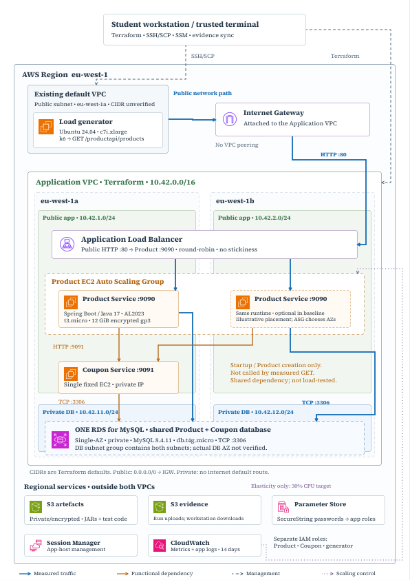

# Cloud Scalability and Resilience CA1

## Project overview

This coursework investigates how horizontal scaling, automatic elasticity and instance replacement affect a Spring Boot application on AWS. It compares one and two Product Service instances, measures the response to changing demand, and examines client failures while Auto Scaling replaces terminated instances.

The infrastructure has been deployed and the four experiments completed. This README covers setup, test execution and cleanup; all AWS operations are performed by the operator from a trusted terminal. This is an assignment environment, with deliberate cost and resilience trade-offs.

## Architecture



- **Application network:** one VPC with two public application/ALB subnets and two private database subnets across two Availability Zones. Application hosts have public IPs for outbound access; there is no NAT Gateway.
- **Product:** an internet-facing ALB accepts HTTP on port 80 from approved client CIDRs and the load generator, then forwards to Product on port 9090. Round-robin routing has stickiness disabled. A Launch Template and Auto Scaling Group (ASG) maintain one or two instances, using `/actuator/health/readiness` and ELB health checks for replacement.
- **Coupon and storage:** one fixed Coupon EC2 instance listens on port 9091, accessible from Product. Both services use one private, Single-AZ MySQL RDS instance on port 3306. Product creation calls Coupon before saving; the measured `GET /productapi/products` reads RDS without calling Coupon. Product startup also checks Coupon availability.
- **Deployment and observation:** S3 holds JARs and test scripts; a separate bucket holds evidence. EC2 roles retrieve database passwords from SSM Parameter Store. CloudWatch collects application logs with 14-day retention and provides resource metrics and CPU scaling alarms.
- **Load generation:** a separate Ubuntu EC2 instance in the account's existing default VPC runs k6 against the ALB. It collects AWS observations and uploads evidence using its instance role.

## Technology stack

Java 17, Spring Boot 4.1.1 (as declared in both POMs), Spring Web, Data JPA and Actuator; Maven; RDS MySQL 8.4.11; 
Terraform `>= 1.9, < 2.0` with AWS provider `>= 6.0, < 7.0`; Amazon Linux 2023 and systemd for the services; Ubuntu 24.04, 
k6 and Python/boto3 for experiments. Local charts use pandas and matplotlib.

## Repository structure

```text
app/productservice/     Product REST API and Maven build
app/couponservice/      Coupon REST API and Maven build
infra/                  Terraform, profiles and operator guides
  templates/            EC2 bootstrap and systemd configuration
  scripts/              Coupon setup and Product pre-start helpers
  sql/                  One-time database schema and initial fixtures
load-tests/             k6 workloads, runner, AWS exports and local charts
tests/                  Script tests and a manual infrastructure/data helper
Makefile                 Operator plan/apply/output-copy/sync/destroy targets
```

`evidence/` and `charts/` are generated locally and ignored by Git. Historical construction plans under `infra/` and `archive-docs/` are not additional deployment stages.

## Deployment

**Deploying creates chargeable AWS resources.** Commands marked **local** run from the repository root on your trusted machine. Commands marked **Coupon**, **Product** or **generator** run on that EC2 host. Terraform provisions resources and uploads files; database setup and test execution are manual.

### 1. Prepare your machine and AWS account

Install Java 17, Maven, Terraform 1.9 or newer (below 2.0), GNU Make, AWS CLI v2, the AWS Session Manager plugin, SSH/SCP, curl and jq. Configure an authorised AWS session locally with permission to provision the resources described above. Never copy AWS credentials to EC2; instances use IAM roles.

In the AWS console, confirm these prerequisites in your chosen region:

- Two Availability Zones and a usable RDS MySQL 8.4.11 instance class.
- A standard Amazon-owned x86_64 Amazon Linux 2023 AMI, release 2023.8 or newer. Both services use this image; its package repository must include `mariadb1011`.
- A Canonical-owned Ubuntu Server 24.04 x86_64 AMI for the generator.
- An existing default VPC and default subnet in the first chosen AZ, with internet routing. Terraform uses these but does not create them.
- An existing EC2 key pair matching the name hard-coded in Terraform. **Local:** display the required name without opening another document:

```bash
awk '/^[[:space:]]*key_name[[:space:]]*=/ {gsub(/"/, "", $3); print $3}' infra/load-generator.tf
```

Create or import that key pair through the EC2 console if it is absent. Keep the matching private key on your machine. Set its path for the commands below:

```bash
export SSH_KEY_PATH=/path/to/private-key
chmod 600 "$SSH_KEY_PATH"
```

### 2. Configure Terraform

Edit `infra/common.tfvars` with your own values. Replace every angle-bracket placeholder; AMI IDs must belong to the selected region. JAR paths are relative to `infra/`.

```hcl
project_name       = "ca1"
aws_region         = "<aws-region>"
availability_zones = ["<first-az>", "<second-az>"]
db_instance_class  = "<supported-rds-instance-class>"
coupon_ami_id         = "<amazon-linux-2023-ami-id>"
load_generator_ami_id = "<ubuntu-24.04-ami-id>"
product_jar_path = "../app/productservice/target/productservice-0.0.1-SNAPSHOT.jar"
coupon_jar_path  = "../app/couponservice/target/couponservice-0.0.1-SNAPSHOT.jar"
product_instance_type        = "t3.micro"
coupon_instance_type         = "t3.micro"
load_generator_instance_type = "c7i.xlarge"
```

The generator size matches the reported experiments; it overrides Terraform's `t3.small` default. The application network defaults to `10.42.0.0/16`, with public subnets `10.42.1.0/24` and `10.42.2.0/24`, and private subnets `10.42.11.0/24` and `10.42.12.0/24`.

Create or edit the ignored `infra/secrets.tfvars` locally with restrictive permissions. Do not overwrite existing protected inputs. Its required settings are:

```hcl
db_name           = "servicedb"
db_user           = "<database-admin-username>"
db_admin_password = "<database-admin-password>"
db_app_password   = "<application-password>"
allowed_client_cidrs = ["<your-public-ip>/32"]
```

Use `servicedb`: the supplied initialisation SQL expects that name. The admin username must start with a letter, contain only letters/numbers, be at most 16 characters, and not be `root`. The admin password must be 8–41 characters without spaces, `/`, `@` or double quotes; the application password must be at least eight characters. Use separate generated passwords. Client CIDRs allow ALB HTTP and generator SSH; the generator's own ALB access is added automatically.

```bash
chmod 600 infra/secrets.tfvars
```

Never commit credentials, private keys, secret-bearing `.tfvars`, Terraform state or plans. State contains passwords even when inputs are marked sensitive. Keep `infra/outputs.json` and evidence containing infrastructure identifiers private.

### 3. Build and provision

**Local:** build the executable JARs, or retain approved existing builds at the configured paths:

```bash
mvn -f app/productservice/pom.xml package
mvn -f app/couponservice/pom.xml package
terraform -chdir=infra init
terraform -chdir=infra validate
make plan PROFILE=baseline
```

Review the plan, then apply:

```bash
make apply PROFILE=baseline
```

The Makefile loads `secrets.tfvars`, then `common.tfvars`, then `baseline.tfvars`. It uses the exported `SSH_KEY_PATH`. Terraform uploads the JARs and test scripts to S3. EC2 bootstrap installs packages, downloads and verifies JARs, and creates systemd services. Generator bootstrap installs Python/boto3, k6 and AWS CLI under `~/ca1`; it does not start tests.

After provisioning, Make writes `infra/outputs.json`, waits for generator bootstrap and copies the outputs over SSH. If the copy fails, infrastructure may already exist. Fix the key, approved CIDR or bootstrap error and retry:

```bash
make copy-outputs
```

Coupon remains disabled until database setup. Product starts automatically, but may initially fail or be replaced while Coupon is unavailable. Complete the next step promptly, then wait for healthy Product capacity.

### 4. Initialise the database and start Coupon

**Local:** get the region and Coupon instance, then open Session Manager:

```bash
REGION=$(terraform -chdir=infra output -raw aws_region)
COUPON_ID=$(terraform -chdir=infra output -raw coupon_instance_id)
terraform -chdir=infra output -raw coupon_jar_sha256
aws ssm start-session --region "$REGION" --target "$COUPON_ID"
```

**Coupon:** wait for bootstrap and compare the JAR checksum with the output above:

```bash
sudo cloud-init status --wait
java -version
sudo sha256sum /opt/ca1/coupon.jar
sudo systemctl status amazon-ssm-agent amazon-cloudwatch-agent --no-pager
```

On a **new, empty database only**, initialise and verify:

```bash
sudo /opt/ca1/coupon-operator.py init
sudo /opt/ca1/coupon-operator.py verify
```

This creates the tables, the restricted `ca1_app` database user, one SAVE10 coupon and two products: Keyboard at 90.00 and Mouse at 40.00. Verification should report matching fixtures, next IDs of 2 for Coupon and 3 for Product, and only SELECT/INSERT/UPDATE/DELETE database grants (plus USAGE). Stop on any error: initialisation can leave partial state and must not be rerun automatically.

After successful checks, enable Coupon and verify its response:

```bash
sudo touch /var/lib/ca1/coupon-enabled
sudo systemctl enable --now coupon
curl --retry 12 --retry-connrefused --retry-delay 5 --fail --silent --show-error \
  http://localhost:9091/couponapi/coupons/SAVE10
exit
```

Expect code `SAVE10`, discount `10.00` (possibly displayed as `10.0`) and expiry `2030-12-31`. Existing deployments skip initialisation. The `verify` command expects the original two-row fixture, so it is not a general health check after adding experiment data. Never initialise on reboot or instance replacement.

### 5. Verify Product, the ALB and logs

**Local:** read current resource outputs and check the group and targets:

```bash
REGION=$(terraform -chdir=infra output -raw aws_region)
ASG_NAME=$(terraform -chdir=infra output -raw product_asg_name)
TARGET_GROUP=$(terraform -chdir=infra output -raw target_group_arn)
ALB_URL=$(terraform -chdir=infra output -raw alb_url)
LOG_GROUP=$(terraform -chdir=infra output -raw application_log_group_name)
aws autoscaling describe-auto-scaling-groups --region "$REGION" \
  --auto-scaling-group-names "$ASG_NAME" \
  --query 'AutoScalingGroups[0].{Desired:DesiredCapacity,Instances:Instances[].{Id:InstanceId,State:LifecycleState,Health:HealthStatus}}'
aws elbv2 describe-target-health --region "$REGION" --target-group-arn "$TARGET_GROUP"
curl -fsS "$ALB_URL/actuator/health/readiness"
curl -fsS "$ALB_URL/productapi/products" | jq .
aws logs tail "$LOG_GROUP" --region "$REGION" --since 10m
```

Before the baseline, expect one healthy `InService` Product instance, one healthy target, readiness `UP`, the two initial products and recent application logs. Wait for pending launches or refreshes to finish. Later profiles require the counts shown below. A healthy GET alone does not verify log delivery.

If Product fails to become healthy, open a session to its current instance:

```bash
PRODUCT_ID=$(aws autoscaling describe-auto-scaling-groups --region "$REGION" \
  --auto-scaling-group-names "$ASG_NAME" \
  --query 'AutoScalingGroups[0].Instances[0].InstanceId' --output text)
terraform -chdir=infra output -raw product_jar_sha256
aws ssm start-session --region "$REGION" --target "$PRODUCT_ID"
```

**Product:** compare the JAR checksum and inspect startup:

```bash
sudo cloud-init status --wait
sudo sha256sum /opt/ca1/product.jar
sudo systemctl status product amazon-ssm-agent amazon-cloudwatch-agent --no-pager
sudo tail -n 50 /var/log/ca1/product.log
curl -fsS http://localhost:9090/actuator/health/readiness
exit
```

Product's pre-start helper retrieves the application password, checks RDS and SAVE10 on Coupon, then starts Java. Both services receive `DB_URL`, `DB_USERNAME` and `DB_PASSWORD`; Product also receives `CUPON_APP_URL=http://<coupon-private-ip>:9091` (intentional spelling). Runtime configuration sets `SPRING_JPA_HIBERNATE_DDL_AUTO=none`. Do not print the protected runtime environment files: they contain passwords. Fix dependency or bootstrap errors before restarting; never reseed to repair startup.

## Experiments

All measured traffic is one `GET /productapi/products` per iteration, with a five-second timeout and no retries, redirects or sleeps. `load-tests/product.js` uses constant arrivals; `product-ramp.js` uses changing arrival rates. Both check HTTP 200 only, **not response-body correctness**.

| Profile | Product min / desired / max | Purpose |
| --- | --- | --- |
| `baseline` | 1 / 1 / 1 | One-instance reference |
| `scaled` | 2 / 2 / 2 | Matched two-instance comparison |
| `elasticity` | 1 / 1 / 2 | CPU target tracking at 30% average ASG CPU |
| `failure` | 2 / 2 / 2 | Manual termination and automatic replacement |

Each profile is `infra/<profile>.tfvars`. CPU scaling is disabled outside elasticity; replacement remains enabled. The elasticity profile overrides the 50% variable default. Default instance warmup is 300 seconds and the ELB health-check grace period is 600 seconds.

### Prepare the dataset

The reported experiments used 1,000 products; fresh database setup creates two. You can test with those two rows, but the results will not be directly comparable with the report.

For a fresh two-row database, the following **optional, one-time local command adds 998 synthetic products** to reach 1,000. First confirm the GET contains exactly the two initial fixtures. Do not run this on an existing experimental dataset or repeat it: the seed endpoint appends rows.

```bash
ALB_URL=$(terraform -chdir=infra output -raw alb_url)
curl -fsS "$ALB_URL/productapi/products" | jq length
# Only after confirming the original two products:
curl -fsS -X POST "$ALB_URL/productapi/products/seed?count=998"
curl -fsS "$ALB_URL/productapi/products" | jq length
```

Expect the final count to be 1,000. This reproduces dataset size, not a verified copy of the historical data. Preserve the same dataset throughout all comparisons. No deletion or repeated schema initialisation is needed.

### Connect and run a smoke test

**Local:** with baseline still applied:

```bash
ssh -i "$SSH_KEY_PATH" ubuntu@$(terraform -chdir=infra output -raw load_generator_public_ip)
```

**Generator:**

```bash
cloud-init status --wait
cd ~/ca1
test -s infra/outputs.json
./.venv/bin/python load-tests/run.py --rate 1 --duration 2m --vus 2
```

The runner reads the profile from the copied outputs; there is no profile argument. Check the printed run folder's `run.json` and `k6.txt`. Proceed only when the endpoint, metric export and evidence upload work. The installed script snapshot remains fixed for the generator's lifetime.

### Baseline and horizontal scaling

**Generator:** run a separate warm-up:

```bash
ALB_URL=$(./.venv/bin/python -c 'import json; print(json.load(open("infra/outputs.json"))["alb_url"]["value"])')
k6 run -e ALB_URL="$ALB_URL" -e RATE=100 -e DURATION=1m -e VUS=2000 load-tests/product.js
```

After warm-up completes, wait until the next UTC minute so its traffic does not share the measurement's CloudWatch bucket. Then measure:

```bash
./.venv/bin/python load-tests/run.py --rate 250 --duration 5m --vus 2000
```

**Local, after the run finishes:** switch to two Product instances:

```bash
make plan PROFILE=scaled
make apply PROFILE=scaled
```

Repeat the group/target checks from deployment and wait for two healthy targets and no pending refresh. Reconnect to the generator and run the **same warm-up and measurement commands**. Keep data, builds, instance types, generator and all workload settings unchanged. Pilot the offered load and VU allocation before a formal comparison; dropped iterations mean some scheduled requests were never sent.

### Automatic scaling

**Local:**

```bash
make plan PROFILE=elasticity
make apply PROFILE=elasticity
```

Wait for one healthy target, then reconnect. **Generator:**

```bash
cd ~/ca1
./.venv/bin/python load-tests/run.py --low-rate 20 --pre-duration 3m \
  --rise-duration 1m --rate 200 --duration 12m --fall-duration 1m \
  --post-duration 4m --vus 2000
```

This schedules 21 minutes: three at low demand, one rising, twelve high, one falling and four low. `--duration` is the high-rate hold. Observe desired capacity, healthy targets and CPU separately; a launch does not immediately provide healthy capacity. These are runnable example settings using the report's load levels, not a guarantee of scale-out or exact reproduction of every historical run setting. Scale-in may occur after the test; the runner's observer stops when k6 stops.

### Instance failure and recovery

**Local:**

```bash
make plan PROFILE=failure
make apply PROFILE=failure
```

Wait for two healthy targets. **Generator:**

```bash
cd ~/ca1
./.venv/bin/python load-tests/run.py --rate 100 --duration 20m --vus 2000
```

While the test runs, use the AWS console to identify a Product instance belonging to this ASG and manually terminate it. Record the instance ID and UTC times immediately before and after the action. Keep desired capacity at two; do not detach the instance or terminate Coupon or the generator. Observe replacement and the return of two healthy targets. The reported trial used four successive disruptions in one run; for a repeat, allow recovery between interventions and retain each action time.

The runner never terminates instances. Do not apply Terraform while any test is running: applying can reset capacity changed by elasticity. Select failure demand using a one-instance pilot so the survivor has a tested workload.

### Save and inspect results

Each run creates `~/ca1/evidence/<run-id>/` with:

- `run.json`: UTC bounds, settings, resources and execution/upload status.
- `k6.csv` and `k6.txt`: raw samples and client summary.
- `ec2_cpu.csv`, `rds_metrics.csv` and `alb_metrics.csv`: CloudWatch exports.
- `aws_observations.jsonl`: timestamped AWS observations for non-baseline trials, normally every 15 seconds.

Collection can take several minutes after k6 stops. The runner attempts S3 upload after normal completion and handled failures. Inspect exit codes, upload status and ALB count reconciliation; a nonzero k6 exit can represent real HTTP failures rather than a broken test. Preserve failed trials and partial output. A hard kill or lost generator can prevent upload.

**Local:** download the evidence and inspect the printed run IDs:

```bash
make sync
ls evidence/
```

Keep HTTP failures separate from dropped iterations. Compare completed and HTTP 200 requests per second, p95 from individual latency samples, and CPU over aligned UTC windows. Do not average p95 values. CloudWatch minute buckets can include adjacent traffic; investigate count mismatches and missing data. Healthy-target observations do not identify the first successful response from a replacement.

For local Python scripts and optional charts, install Python 3 with venv support. From the repository root, create a virtual environment and install the dependencies in `requirements.txt`:
```bash
python3 -m venv .venv
./.venv/bin/python -m pip install -r requirements.txt
```


Then generate charts with:
```bash
./.venv/bin/python load-tests/charts.py \
  "evidence/<baseline-run-id>" "evidence/<scaled-run-id>" \
  --output-dir "charts/<new-comparison-name>"
```

Replace the placeholders with downloaded run folders and a new output directory. The script produces throughput, latency, CPU, HTTP-failure and dropped-iteration PNGs without changing raw evidence.

## Key findings

These results were recorded in Chapter 4 of the coursework report; they are not guarantees for another deployment:

| Experiment | Recorded outcome |
| --- | --- |
| One versus two Product instances | At 250 requests/s for five minutes, both completed 75,001 requests with no HTTP failures or drops. Mean latency fell from 28.753 to 11.746 ms; p95 fell from 34.738 to 15.411 ms. Throughput stayed approximately 250 requests/s; median latency increased slightly. |
| Resource use | Original Product CPU fell from 53.64% to 27.04%; the second instance averaged 30.54%. RDS CPU remained similar (26.71% versus 27.35%), while connections rose from 20 to 30. |
| Elasticity | At 20 → 200 → 20 requests/s, two healthy targets were observed about eight minutes after demand began rising. Of 165,599 requests, 31 timed out (0.019%); none were dropped. Desired capacity returned to one after client testing ended. |
| Failure recovery | At 100 requests/s for 20 minutes, four disruptions restored two healthy targets in approximately 2:43–3:49 each. Of 120,000 requests, 2,705 timed out (2.25%); none were dropped. Replacement restored capacity but did not preserve uninterrupted service. |

## Limitations and improvements

Coupon and Single-AZ RDS remain shared failure points. Coupon is not exercised by the GET workload but is required for Product startup. HTTP, public application IPs and broad application egress are security trade-offs; backups and RDS deletion protection are disabled for this disposable environment.

Each experiment was run once; the four failures occurred within one trial. T3 credits and background activity may affect comparisons. Tests establish neither maximum capacity nor resilience to Coupon, RDS or AZ failure. HTTP 200 checks do not prove body correctness, and there is no response-instance attribution or configured access-log collection. Polling gives bounded observations rather than exact recovery times.

The proposed improvements are a versioned AMI containing Java and the JAR to reduce launch-time installation/download work, and private application subnets with suitable outbound connectivity. These improvements are **not implemented or measured**; they add image maintenance or networking cost. Keeping spare Product capacity could reduce exposure to scaling delays at additional running cost.

## Cleanup

From the repository root on your trusted machine, download and verify evidence **before** destroying resources:

```bash
make sync
# After checking the downloaded evidence; use the currently provisioned profile:
make destroy PROFILE=baseline
```

Destroy prompts for approval and removes Terraform-managed infrastructure. The evidence bucket has `force_destroy = true`, so all its contents are deleted without an automatic sync. RDS has zero backup retention and `skip_final_snapshot = true`: destruction does not preserve a final database snapshot. Export anything needed beforehand.

Terraform manages the uploaded artefacts, but the artefact bucket is not force-emptied; manually added objects can block deletion and require operator review. The existing default VPC/subnet and EC2 key pair are external prerequisites and remain. Any manually created snapshots or other out-of-band resources require separate review and cleanup. Local evidence, charts, JARs and protected Terraform files remain; the Makefile removes only `infra/outputs.json` after successful destroy. Keep state securely until teardown is confirmed.
